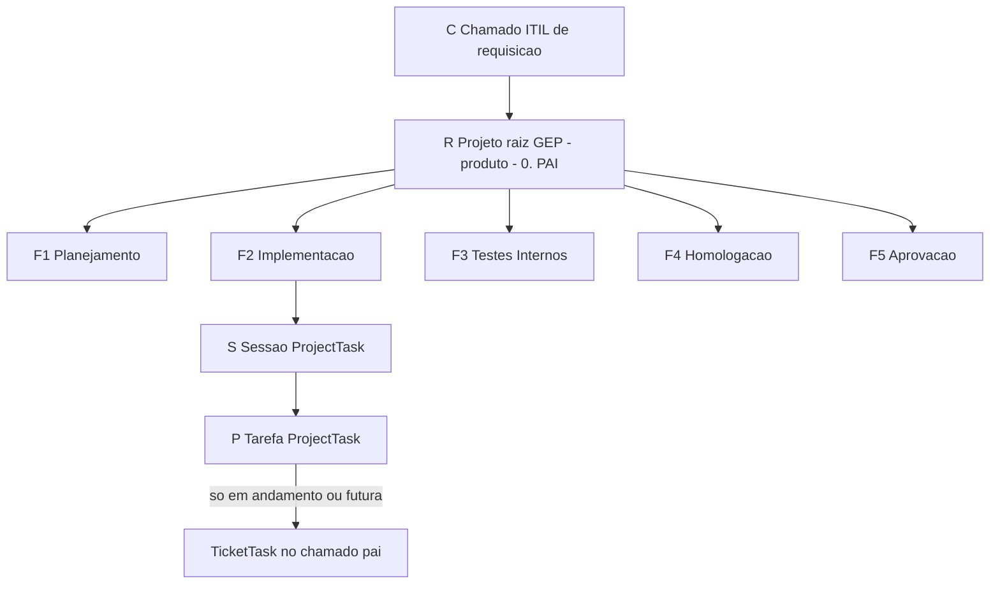

# Guia de uso da integração VS Code para o GLPI

Roteiro para levar um projeto do editor até o GLPI. Há dois caminhos: abrir um projeto novo a partir de um chamado de requisição, ou ligar um projeto que já está em andamento. A manutenção diária é a mesma nos dois.

Este texto não substitui o manual de instalação nem o de comandos. Instalação, presets e assistentes: [`MANUAL_INTEGRACAO_GLPI.md`](MANUAL_INTEGRACAO_GLPI.md). CLI, configs e troubleshooting: [`MANUAL_USO_GLPI.md`](MANUAL_USO_GLPI.md). Códigos: skill `convencao-codigos-glpi`.

O clone certo do kit é a branch `fix/convencao-codigos-relativos` de [toolkit-agentes-skills](https://github.com/RicardoDavitec/toolkit-agentes-skills). A branch `main` pública ainda é o esqueleto antigo, sem o kit GLPI.

```bash
git clone -b fix/convencao-codigos-relativos \
  https://github.com/RicardoDavitec/toolkit-agentes-skills.git
```

Segredos ficam em `~/.secrets/glpi.env` (ou no legado `~/.secrets/GLPI-tokens.txt`). Não entram no plano, no commit nem no conteúdo gravado no GLPI. Homologação (`suporte-homolog`) antes de produção (`suporte.franca.sp.gov.br`). O CLI seleciona o ambiente com `--env=homolog` ou `--env=prod`.

## Regras que valem nos dois caminhos



- O chamado (C) e o projeto (R) aparecem uma vez, no cabeçalho do plano, com o id. Itens, títulos e comentários usam só `F#`, `F#.S#` e `F#.S#.P#`.
- O projeto não é filho do chamado. O vínculo é um registro `Itil_Project`: `itemtype` Ticket, `items_id` o id do chamado, `projects_id` o id do projeto.
- No preset PMF (`api-vscode-glpi`) as cinco fases são subprojetos. Sessão e tarefa são `ProjectTask`. A fase não recebe o prefixo `GEP - `.
- Nome do projeto raiz: o molde em `naming.root` é `GEP - {produto} - 0. [PAI]`. Sem projeto pai, `glpi project create` chama `tools/glpi/lib/crfsp.py` e grava o molde inteiro, sem repetir `GEP - `.
- As cinco fases são fixas: F1 Planejamento, F2 Implementação, F3 Testes Internos, F4 Homologação, F5 Aprovação.
- Toda fase, sessão e tarefa leva início planejado, fim planejado, duração planejada e duração efetiva. No realizado, as datas reais e a duração efetiva saem do comentário do plano ou do `git log`. No planejado, as duas datas são obrigatórias e a duração efetiva fica 0. A duração é o intervalo, em segundos. A fase e a sessão usam a janela que cobre os filhos.
- Nesta instância o projeto e a fase não têm coluna de duração. As datas ficam nos campos. As duas durações ficam na última linha do conteúdo.
- O planejamento futuro e o que está em andamento aparecem no chamado pai como tarefa do chamado (`TicketTask`), na aba Tarefas. É o formato do [chamado 15817](https://suporte.franca.sp.gov.br/front/ticket.form.php?id=15817). Pacote concluído não entra nesse espelho. O texto visível leva o código curto. A regra completa (legado do plano de 15/10) está em `docs/05_progresso/legados/espelhamento_chamado_itil_crfsp-15_10_26-13_45.md` e no anexo `docs/05_progresso/legados/anexos/F1_S1_levantamento_e_decisoes-15_10_26.md`. O chamado ITIL deste template em produção é o [16531](https://suporte.franca.sp.gov.br/front/ticket.form.php?id=16531).
- Sem o grupo Desenvolvimento no time do projeto, a aba Tarefas da fase abre vazia mesmo com tarefas gravadas.

Cabeçalho de um plano que já tem chamado e projeto:

```text
> Chamado ITIL (C): 15817 (producao)
> Projeto/Requisicao (R): 12 - "GEP - Botao de Panico - 0. [PAI]"
> Piloto: Bot_Pan | Data: DD/MM/AAAA
```

Troque os ids pelos do documento. Sem chamado definido, omita as três linhas.

### O que ainda é passo manual

Não há comando `glpi ticket create` nem `glpi itil-link`. O chamado de requisição abre-se na interface. O vínculo `Itil_Project` grava-se na API, com `itemtype` Ticket, `items_id` e `projects_id`. Produção só depois da conferência em homologação, e o espelho em produção exige `--confirm-prod`.

## Caminho 1 — projeto novo

### 1. Chamado de requisição

Abra o chamado ITIL de requisição no GLPI e anote o id. Em conferência, use homologação. Não crie o chamado de teste no lugar do de produção.

Exemplo já exercido: chamado de produção 15817 e, em homologação, o chamado 11066, ligado ao projeto 83. Produção não foi alterada nesse teste.

### 2. Inicializar o editor a partir do template

Clone a branch citada no início e abra essa pasta no VS Code ou no Cursor. Do clone do kit, grave o preset no projeto novo:

```bash
./scripts/bootstrap-into.sh /caminho/do-projeto \
  --preset=api-vscode-glpi \
  --profile=pmf-core \
  --key=nome-curto \
  --ticket=ID_DO_CHAMADO
```

`--project` entra quando o projeto GLPI já existir. Até lá, `.glpi/project.yaml` fica com `ticket_id` preenchido e `project_id` vazio. Agentes que passam a valer neste repositório: `glpi-orquestrador`, `glpi-escriba`, `glpi-auditor` e `glpi-migrador`. Skills de plano e de código: `documente-o-plano`, `convencao-codigos-glpi`, `commit`, `encerrar-sessao`, `acompanhar-chamado`.

### 3. Árvore do repositório

- `docs/05_progresso/planos_ativos/` — só o plano vigente e os anexos dele. Plano encerrado vai para `docs/05_progresso/legados/`.
- `docs/05_progresso/geral/` — sessão do dia (`SESSAO_*`).
- `docs/05_progresso/pendencias/` — pendência atemporal, fora do plano.
- `docs/06_glpi/` — este guia, os manuais e os artefatos de retro-scan.
- `.glpi/project.yaml` — ids do chamado e do projeto, por ambiente. O bloco `homolog:` só aponta o ensaio enquanto ele estiver ativo.
- `apps/` — código do produto, quando houver.

### 4. Planos nas cinco fases

Skill `documente-o-plano`. Um plano curto: organograma e um parágrafo por sessão. Detalhe em anexo. Cada sessão e cada tarefa nasce com janela:

```text
- [ ] **F2.S1** Primeira sessao de implementacao
  <!-- glpi: code="F2.S1" plan_start="2026-10-22 09:00" plan_end="2026-10-22 18:00" -->

  - [ ] **F2.S1.P1** Primeira tarefa
    <!-- glpi: code="F2.S1.P1" plan_start="2026-10-22 09:00" plan_end="2026-10-22 11:00" -->
```

Tarefa sem data no plano recebe, na criação do chamado, um bloco estipulado de 2 h em horário de expediente. Não invente `real_start` nem `real_end`: eles entram quando houver commit ou sessão.

Confira o prefixo longo antes de publicar o plano:

```bash
python .github/skills/convencao-codigos-glpi/scripts/checar_prefixo.py
```

### 5. Refletir a estrutura debaixo do chamado

Ordem, sempre com `--env=homolog` enquanto for ensaio, e `--apply` só depois de ler o dry-run:

1. `glpi project create --name="Nome do produto" --apply`. Sem pai, o nome gravado é `GEP - Nome do produto - 0. [PAI]`.
2. Grave o id em `.glpi/project.yaml` (`project_id` e, no ensaio, o bloco `homolog:`).
3. Ligue o chamado ao projeto com `Itil_Project` (`itemtype` Ticket, `items_id`, `projects_id`). No teste o vínculo da homologação foi o registro 64.
4. Crie as cinco fases como subprojetos, com `--parent-project` igual ao id do raiz e nomes `F1. Planejamento`, `F2. Implementação`, `F3. Testes Internos`, `F4. Homologação`, `F5. Aprovação`. Sem prefixo `GEP - `. Cada fase leva Estado e Data de criação: sem `--state`, o CLI grava `gep1`; sem `--date`, grava o instante no campo `date`. "Última atualização" (`date_mod`) não substitui `date`.
5. Não use `glpi seed-phases` com o template padrão: ele ainda semeia as sessões antigas como se fossem fases.
6. Inclua o grupo Desenvolvimento no time do projeto raiz e de cada fase.
7. Grave sessões e tarefas com `glpi task upsert`: sessão com `projecttasks_id` 0 na fase; tarefa com o id da sessão como pai. Leve `plan_start_date`, `plan_end_date`, `planned_duration` e `effective_duration`. No planejado, a efetiva é 0. Na criação, sem `--state`, o estado é `gep1` e a Data de criação vai em `date_creation`. Atualizar uma tarefa já existente não recoloca esse estado nem reescreve `date_creation`.
8. Abra a fase no GLPI, não a aba de tarefas do projeto raiz, para ver sessão e tarefa.

O `glpi-retro-scan` completa, em todo `F`, `S` e `P`, início planejado, fim planejado, duração planejada e duração efetiva. Realizado sem data no plano busca o `git log`. Planejado sem data recebe um bloco de 2 h e duração efetiva 0. `glpi-temporal-fill` continua útil para preencher no GLPI uma lacuna que já tenha data real gravada.

### 6. Espelhar o planejamento futuro no chamado

Só pacote em andamento (`[~]` ou `[t]`) ou futuro (`[ ]` com início planejado). Concluído fica no projeto e não nasce de novo no chamado.

Cada espelho é uma `TicketTask` do chamado pai, como as tarefas do chamado 15817:

- `tickets_id` do chamado pai
- texto com o código curto, por exemplo `F2.S1.P1`
- `begin` e `end` iguais à janela planejada
- `actiontime` igual a essa janela quando ela cabe em 8 h; senão, 2 h (7200 s)
- `state` 1 (A fazer)
- `is_private` 0
- técnico e grupo do preset (no ensaio PMF, usuário da API e grupo Desenvolvimento)
- sem modelo e sem categoria enquanto o catálogo tiver `glpi_id` nulo

```bash
./tools/glpi/glpi --env=homolog ticket-mirror
./tools/glpi/glpi --env=homolog ticket-mirror --apply
./tools/glpi/glpi --env=homolog ticket-mirror --apply --ticket=11066
```

O padrão é dry-run. `--apply` grava. Em produção, `--apply` sem `--confirm-prod` recusa. Se o código já está no texto de uma `TicketTask`, a execução seguinte pula esse item e não reescreve edição humana. Não use `force_purge`. No teste do Bot_Pan, as 47 tarefas em andamento e futuras já estão na aba Tarefas do chamado de homologação 11066; uma nova execução tem de pulá-las.

## Caminho 2 — projeto já em andamento

### 1. Chamado de origem

Use o chamado ITIL que originou o trabalho. Se o projeto GLPI ainda não aponta para ele, crie o `Itil_Project` como no passo 5 do caminho 1. Não abra um segundo projeto raiz para o mesmo produto.

### 2. Trazer o kit, se o repositório ainda não o tem

A fonte da correção é o clone do template, na mesma branch. No produto, o sync delega a esse clone. Não edite a cópia local como se ela fosse o kit.

```bash
# a partir do clone do template
./scripts/upgrade-into.sh --target=/caminho/do-projeto --apply --yes
```

O atalho `scripts/atualizar-kit` do produto deve chamar o `atualizar_kit.py` do kit. Se ele repassar `--profile` e o upgrade recusar a flag, chame `upgrade-into.sh` direto, como acima.

### 3. Adaptar a codificação antiga

Códigos de plano antigo (`S0`, `S0.P1`, `M.DOCS`, `8.2.A`) passam a `F#.S#.P#` no plano vigente (o `--pack` também emite só esses códigos). Um título `## R1` de markdown antigo não é o projeto GLPI. Não grave o código longo de chamado e projeto em item, comentário ou nome de arquivo.

Mapeamento usado no ensaio do Bot_Pan, só como exemplo de leitura: linhas de auditoria, requisito, contingência, sala e perfil foram para a fase F2; demonstração foi para a fase F4. F1, F3 e F5 podem ficar sem sessão até existir trabalho nelas. A decisão de para qual fase vai cada plano antigo é do produto, revista antes de gravar.

Rode de novo o `checar_prefixo.py`.

### 4. Retro-scan

O scan só produz artefato para revisar. Não grava no GLPI.

```bash
./tools/glpi/glpi retro-scan --no-pack
```

A saída declara chamado e projeto só no cabeçalho, fases `F1` a `F5`, sessão `F#.S#` e tarefa `F#.S#.P#`. Código antigo `S0` ou título `## R1` não vira fase nem projeto. Revise o JSON antes de `glpi-retro-apply`. O scan de 21/10/2026 (`0951`) foi gerado antes desta correção e não se aplica.

### 5. Aplicar e espelhar o que já existe

Depois da revisão:

- Fase, sessão e tarefa concluídas: datas e duração efetiva do comentário do plano ou do primeiro e do último commit que citam o código. Commit sem intervalo: duração efetiva 0 e janela planejada de 2 h a partir desse instante.
- Em andamento e futuras: início e fim planejados obrigatórios; duração efetiva 0.
- Fase vazia (sem sessão): janela estipulada e duração efetiva 0. Não invente commit.
- Espelho no chamado: só o que está em andamento ou é futuro, com as mesmas regras do passo 6 do caminho 1.

No ensaio, isso ficou no projeto 83 (`GEP - Botão do Pânico`) e no chamado 11066, ambos em homologação. O chamado 15817 não recebeu esse espelho.

### 6. Manutenção diária

A mesma seção abaixo.

## Manutenção diária

Uma vez por tarefa, na ordem do dia. Vale para os dois caminhos.

1. Comece o item aberto. No plano, `[~]` e `real_start` com a hora real. Não invente essa hora.
2. Implemente só o critério daquele `F#.S#.P#`.
3. Feche o item: `[x]`, percentual 100 e `real_end`. A sessão pai só fecha quando todas as tarefas dela estiverem fechadas.
4. Commit pela skill `commit`: um commit por tarefa, gitmoji, tipo, escopo, texto sem acento e carimbo `_DD-MM-AA_hh-mm`. O plano atualizado entra no mesmo commit. Exemplo: `✨ feat(glpi): fecha a tarefa de health check_21-10-26_16-40`.
5. Atualize a `ProjectTask`: estado, percentual, as duas datas planejadas, as duas datas reais se houver, duração planejada e duração efetiva. A sessão e a fase ficam com a janela que cobre os filhos.
6. Se essa tarefa já estava na aba Tarefas do chamado e acabou de fechar, a `TicketTask` passa a Feito (`state` 2). Tarefa nova em andamento ou futura entra no espelho, sem duplicar o código.
7. No fim do dia, skill `encerrar-sessao`: arquivo `SESSAO_AAAA-MM-DD_*.md` em `docs/05_progresso/geral/`. Acompanhamento no chamado (`acompanhar-chamado`, `ITILFollowup`) só depois que o operador confirmar o texto.
8. Push só quando for pedido. Produção só depois da conferência em homologação. Nenhum segredo no conteúdo.

## Ferramentas e scripts

Tudo abaixo roda a partir da raiz do repositório. `--env=homolog` no ensaio. Sem `--apply`, o comando que grava só mostra o que faria.

### CLI `./tools/glpi/glpi`

| Comando | Para que serve | Como usar |
|---------|----------------|-----------|
| `auth` | Confere token e sessão | `./tools/glpi/glpi --env=homolog auth` |
| `ticket get` | Lê o chamado | `ticket get` ou `ticket get 11066` |
| `ticket followup` | Envia acompanhamento | `ticket followup 11066 "texto"` |
| `project get` / `project tasks` | Lê o projeto e as tarefas | `project get 83` |
| `project create` | Cria o projeto. Sem pai, aplica o molde `GEP - {produto} - 0. [PAI]` | `project create --name="Produto"` e, depois da leitura, `--apply` |
| `ticket-mirror` | Espelha tarefa em andamento e futura no chamado pai | `ticket-mirror` e, em homologação, `ticket-mirror --apply` |
| `task get` / `task upsert` | Lê ou grava sessão e tarefa | `task upsert` com as quatro datas e durações |
| `seed-phases` | Semeia fases a partir de um template | Não use o padrão `samu-s-phases`: ele trata sessão antiga como fase |
| `retro-scan` | Gera JSON e Markdown F/S/P, sem gravar | `retro-scan --pack` ou o atalho da tabela seguinte |
| `retro-apply` | Grava o JSON revisado | `retro-apply --from=ARQUIVO` e só então `--apply` |
| `states discover` | Descobre estados do projeto | `states discover --preset=api-vscode-glpi` |
| `document attach` | Anexa arquivo a chamado, projeto ou tarefa | `document attach --file=CAMINHO --ticket` |

### Atalhos em `tools/glpi/bin/`

| Atalho | Para que serve |
|--------|----------------|
| `glpi-ticket-mirror` | O mesmo que `glpi ticket-mirror` |
| `glpi-retro-scan` | Varre planos e git e grava o relatório em `docs/06_glpi/retro-scans/` |
| `glpi-retro-apply` | Aplica o JSON revisado |
| `glpi-tree-validate` | Recusa código que não seja `F#`, `F#.S#` ou `F#.S#.P#` e avisa data faltando |
| `glpi-temporal-fill` | Preenche no GLPI a duração que já tem data real |
| `glpi-project-create` | Atalho de `project create` |
| `glpi-task-upsert` | Atalho de `task upsert` |
| `glpi-seed-phases` | Atalho de `seed-phases` |
| `glpi-followup` | Atalho do acompanhamento |
| `glpi-document-attach` | Atalho do anexo |
| `glpi-weekly-sheet.py` | Monta o quadro semanal a partir dos planos e do backlog |

### Scripts de kit

| Script | Para que serve | Como usar |
|--------|----------------|-----------|
| `scripts/bootstrap-into.sh` | Leva o preset para um projeto novo | `--preset=api-vscode-glpi --profile=pmf-core --key= --ticket=` |
| `scripts/upgrade-into.sh` | Atualiza o kit já instalado no produto | `--target=/caminho/do-projeto --apply --yes` |
| `scripts/atualizar-kit` | Atalho do produto para o upgrade | Se recusar `--profile`, chame `upgrade-into.sh` direto |
| `tools/glpi/lib/crfsp.py` | Molde do nome, classificação F/S/P e as quatro datas | O `project create` e o `retro-scan` já chamam; `--format-root-name "Produto"` só imprime o molde |
| `checar_prefixo.py` | Recusa código longo de chamado e projeto fora do cabeçalho | `python .github/skills/convencao-codigos-glpi/scripts/checar_prefixo.py` |

### Skills e agentes

| Nome | Para que serve |
|------|----------------|
| `documente-o-plano` | Abre ou atualiza o plano com `F#.S#.P#` e as datas |
| `convencao-codigos-glpi` | Diz onde cabe chamado, projeto, fase, sessão e tarefa |
| `glpi-retro-scan` | Conduz o levantamento sem gravar |
| `glpi-tree-validate` | Confere a árvore antes do apply |
| `commit` | Um commit por tarefa, com o plano no mesmo commit |
| `encerrar-sessao` | Fecha o dia em `docs/05_progresso/geral/` |
| `acompanhar-chamado` | Envia o texto de acompanhamento depois da confirmação |
| `glpi-orquestrador`, `glpi-escriba`, `glpi-auditor`, `glpi-migrador` | Agentes que aplicam a mesma árvore e o mesmo molde de nome |

O chamado de produção 15817 permanece como exemplo de leitura. Este roteiro não grava nele.
