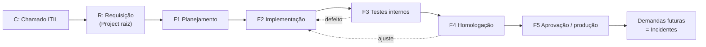

# G01 – Visão geral do padrão

## 1. Propósito

Garantir que todo projeto do template tenha documentação completa, rastreável e atualizada, a partir de um fluxo único: **chamado → requisição → fases → sessões → tarefas**.

## 2. Princípios

1. **Docs-as-Code (documentação como código).** Tudo é Markdown versionado no Git, revisado em PR.
2. **O plano diz o que vai acontecer; o commit diz o que aconteceu.** Os dois se encontram no mesmo código `F#.S#.P#`.
3. **Fonte única.** O que pode ser gerado (ER, dicionário, matriz de rastreabilidade) é gerado, não digitado.
4. **Nada de invenção.** Não se inventa regra de negócio nem data realizada. Falta de requisito vira *ação de documentar*.
5. **Sem segredo e sem dado pessoal real** em nenhum documento.
6. **Gradual.** O lint começa com avisos e endurece por fase.

## 3. Siglas

| Sigla | Significado |
|---|---|
| C | Chamado ITIL (Information Technology Infrastructure Library) aberto no GLPI (Gestão Livre de Parque de Informática) |
| R | Requisição = projeto raiz que nasce do chamado |
| F | Fase, de F1 a F5 |
| S | Sessão, Semana ou Sprint (janela de tempo dentro de uma fase) |
| P | Pacote de tarefa (cerca de 2 horas) |
| RN | Regra de Negócio |
| REQ | Requisito |
| ADR | Architecture Decision Record (registro de decisão de arquitetura) |
| DoD | Definition of Done (definição de pronto) |
| ER | Entidade-Relacionamento |
| LGPD | Lei Geral de Proteção de Dados (Lei nº 13.709/2018) |

## 4. Padrões de referência

| Padrão | Uso neste template |
|---|---|
| ISO/IEC/IEEE 42010 | Descrição de arquitetura (pontos de vista e visões) |
| IEEE 1016 | Descrição de projeto de software |
| ISO/IEC/IEEE 29148 | Requisitos |
| ISO/IEC/IEEE 29119 | Testes de software |
| ISO/IEC/IEEE 15289 | Conteúdo dos documentos do ciclo de vida |
| ISO/IEC 11179 e 25012 | Metadados e qualidade de dados |
| DAMA-DMBOK | Gestão de dados |
| C4 Model, arc42 | Diagramas e estrutura arquitetural |
| ITIL | Chamados, incidentes e mudanças |
| LGPD | Proteção de dados pessoais |

## 5. Mapa das pastas

| Pasta | Conteúdo | Padrão |
|---|---|---|
| `00_visao_geral` | Contexto, escopo, partes interessadas | 42010, C4 nível 1 |
| `01_requisitos` | REQ, RN, glossário | 29148 |
| `02_arquitetura` | Arquitetura e ADRs | 1016, arc42 |
| `03_implementacao` | Guias técnicos, testes, homologação | 15289, 29119 |
| `04_operacao` | Runbooks, backup, monitoramento | ITIL |
| `05_progresso` | Planos, anexos, pendências, legados | Fluxo F/S/P |
| `06_glpi` | Integração com o GLPI | ITIL |
| `07_doc_academica` | Textos acadêmicos | ABNT |
| `08_imagens` | Diagramas e imagens | C4, UML |
| `09_dados_e_tabelas` | ER, dicionário, LGPD | 11179, 25012 |
| `10_setup` | Ambiente de desenvolvimento | Docs-as-Code |
| `11_ia` | Regras para agentes | – |
| `12_padrao_documentacao` | Este padrão | – |

## 6. Ciclo de vida

## 7. Documentos por fase

| Documento | F1 | F2 | F3 | F4 | F5 |
|---|:-:|:-:|:-:|:-:|:-:|
| Visão, requisitos, RN, glossário | **Criar** | Atualizar | Consultar | Consultar | Atualizar |
| Arquitetura e ADR | **Criar** | Atualizar | Consultar | Consultar | Atualizar |
| Dicionário de dados e ER | **Criar** | **Atualizar** | Consultar | Consultar | Atualizar |
| Planos e anexos (F/S/P) | **Criar** | **Atualizar** | Atualizar | Atualizar | Atualizar |
| Pendências | Criar | Criar | Criar | Criar | Criar |
| Plano e relatório de testes | Planejar | | **Criar** | | |
| Roteiro e ata de homologação | Planejar | | | **Criar** | |
| Runbooks | Esboçar | Atualizar | Validar | Validar | **Criar** |
| Relatório de fase | | | | | Em cada fase |

## 8. Portões de passagem (DoD por fase)

| Fase | Só encerra quando… |
|---|---|
| F1 | Requisitos e RN aprovados; arquitetura e ADRs registrados; planos com F/S/P e datas; riscos listados |
| F2 | Todas as P concluídas ou convertidas em pendência; planos e documentos atualizados; GLPI sincronizado |
| F3 | Plano de testes executado; defeitos tratados; nenhum requisito obrigatório sem teste |
| F4 | Roteiro executado com o usuário final; ata registrada; ajustes tratados |
| F5 | Runbooks validados; período de acompanhamento cumprido; transição para incidentes formalizada |

## 9. Quando usar cada guia

| Situação | Guia |
|---|---|
| Vou abrir um projeto novo | G02, G04 |
| Vou implementar | G05, G09 |
| Mexi no banco de dados | G11, G12 |
| Preciso desenhar algo | G13 |
| Vou subir para o GLPI | G10 |
| Configuro o Cursor | G14 |
