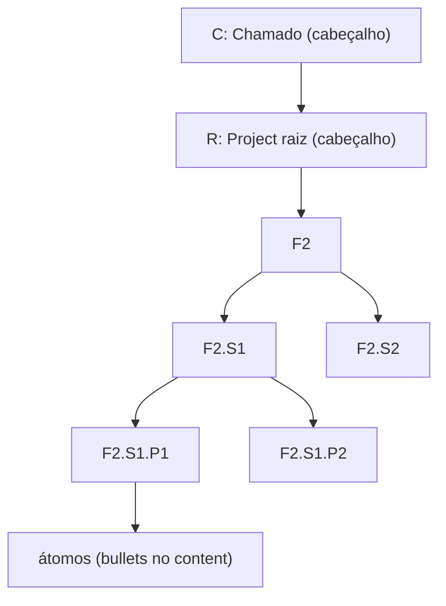

# G02 – Hierarquia C / R / F / S / P

Este guia resume `docs/06_glpi/HIERARQUIA_F_S_P_GLPI.md`, que é a fonte canônica. Em caso de divergência, vale aquele arquivo.

## 1. Os cinco níveis

| Nível | Código | Onde aparece | GLPI |
|---|---|---|---|
| **C** | número do chamado | **Só no cabeçalho** do plano ou JSON | Ticket ITIL (`tickets_id`) |
| **R** | número do projeto | **Só no cabeçalho** | Project raiz + `Itil_Project` |
| **F** | `F1` a `F5` | Árvore do plano | Project filho ou ProjectTask de nível 1 |
| **S** | `F#.S#` | Árvore do plano | ProjectTask (sessão, semana) |
| **P** | `F#.S#.P#` | Árvore do plano | ProjectTask (cerca de 2 h) |
| Átomo | – | Só dentro do `content` do P | Não vira item no GLPI |



## 2. As cinco fases

| Código | Fase | Sigla no kit | Foco |
|---|---|---|---|
| F1 | Planejamento | PLAN | Requisitos, RN, arquitetura, planos |
| F2 | Implementação | IMPL | Executar os planos |
| F3 | Testes internos | TINT | Em paralelo e após a implementação, de forma recursiva |
| F4 | Homologação | HOMO | Testes com o usuário final |
| F5 | Aprovação | APRO | Acompanhamento em produção e refinamento |

No kit F5 se chama "Aprovação". Em cada produto, o conteúdo da fase pode descrever refinamentos em produção.

## 3. Regras

1. **Numeração de S por fase.** A primeira sessão de F3 é `F3.S1`.
2. **P tem cerca de 2 h.** Mais de 4 h deve ser quebrado (validação V11).
3. **A janela do filho cabe dentro da janela do pai** (validação V04).
4. **O nome de S** descreve o escopo da fase e o tema dos P filhos. Nunca use só o código.
5. **Datas são obrigatórias** em F, S e P: `inicio`, `fim`, `inicio_real`, `fim_real`. O real fica **vazio** até haver evidência.
6. **Códigos legados descontinuados:** `PR`, `PH`, `R`, `H`, `I`, `S4` (sem fase), `M.BACKEND`, `S0`. Migrar com `./tools/glpi/bin/glpi-migrate-codes --dry-run`.
7. **Prefixo do projeto raiz** (`GEP - …`) não entra em F, S nem P.

## 4. Cabeçalho do documento

```text
> **Chamado ITIL (C):** 00000 (produção)
> **Projeto/Requisição (R):** 00 - "GEP - Produto - 0. [PAI]"
```

Troque pelos ids reais. Sem chamado definido, omita as linhas.

## 5. Um chamado, várias requisições

Um chamado (C) pode gerar **N requisições** (R1, R2, R3…). **Cada R é exatamente um projeto**: um Project raiz no GLPI, ligado ao chamado por `Itil_Project`. O nome "requisição" existe apenas para caber na estrutura do GLPI.

Consequências:

- Cada R tem as suas próprias fases F1 a F5, os seus planos e a sua documentação.
- O cabeçalho de um plano cita **um** C e **um** R.
- Documentos comuns a vários R do mesmo produto (por exemplo, o glossário) ficam sem R no cabeçalho.
- Para o GLPI, C e R vão por id (`tickets_id`, `projects_id`), nunca no texto dos itens.

## 6. Como citar nos documentos

| Contexto | Forma |
|---|---|
| Item de plano | `**F2.S1.P1**` |
| Comentário GLPI | `<!-- glpi: code="F2.S1.P1" … -->` |
| Documento de apoio | Campo `codigo: F2.S1.P1` no front matter (G03) |
| Texto corrido | "tarefa F2.S1.P1" |
