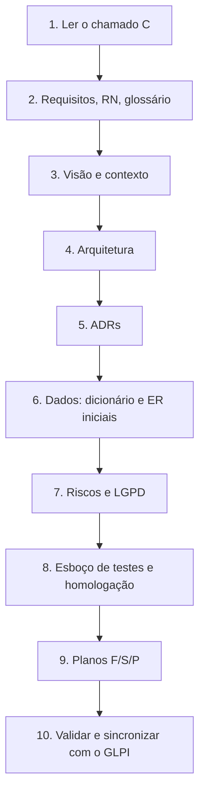

### `01_guias/G04_fase_f1_planejamento.md`

````markdown
---
id: GUI-004
tipo: guia
titulo: Fase F1 – Planejamento
status: rascunho
versao: 0.1.0
data: 2026-11-09
autor: Ricardo
classificacao: publico
---

# G04 – Fase F1: Planejamento

**Objetivo:** produzir a maior parte da documentação de projeto antes de escrever código.

## 1. Sequência



## 2. Passo a passo

| # | Ação | Documento | Modelo |
|---|---|---|---|
| 1 | Ler o chamado e registrar o objetivo | `vis_` | `MOD_visao` |
| 2 | Levantar requisitos e RN com o solicitante | `req_`, `rn_`, `glo_` | `MOD_requisito`, `MOD_regra_negocio`, `MOD_glossario` |
| 3 | Desenhar contexto (C4 nível 1) | `vis_` | G13 |
| 4 | Definir arquitetura: servidores, software, banco de dados, Docker, ferramentas | `arq_` | `MOD_arquitetura_arc42` |
| 5 | Registrar cada escolha relevante | `adr_` | `MOD_adr` |
| 6 | Modelar dados e classificar dados pessoais | `dic_` | G11, G12 |
| 7 | Listar riscos (probabilidade, impacto, mitigação) | seção de `arq_` | – |
| 8 | Esboçar plano de testes e roteiro de homologação | `tst_`, `hml_` | `MOD_plano_testes` |
| 9 | Criar os planos F/S/P | plano | skill `documente-o-plano` |
| 10 | Validar o plano e subir ao GLPI | – | G10 |

## 3. Regras

- **Requisito vazio ou incoerente:** registre uma *ação de documentar*. Não invente RN.
- **Plano curto:** organograma e um parágrafo por S. O detalhe vai nos anexos.
- Todo requisito deve poder virar pelo menos um P e um teste.
- Cada decisão que mude custo, segurança ou prazo exige um ADR.

## 4. Estrutura arc42 (arquitetura)

1. Introdução e metas
2. Restrições
3. Contexto e escopo
4. Estratégia da solução
5. Visão de blocos
6. Visão de execução
7. Visão de implantação
8. Conceitos transversais
9. Decisões (links para os ADRs)
10. Requisitos de qualidade
11. Riscos e dívida técnica
12. Glossário

## 5. Checklist de saída (DoD da F1)

- [ ] Requisitos e RN aprovados (`status: aprovado`)
- [ ] Glossário com siglas do domínio
- [ ] Arquitetura com visão de implantação
- [ ] ADR para cada decisão relevante
- [ ] Dicionário de dados inicial, se houver banco
- [ ] Classificação LGPD dos dados previstos
- [ ] Riscos registrados
- [ ] Planos com F, S e P, datas planejadas e critérios de aceite
- [ ] Plano validado e sincronizado com o GLPI
