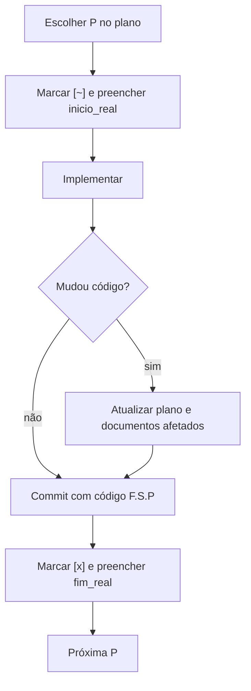

# G05 – Fase F2: Implementação

**Objetivo:** executar os planos e manter toda a documentação refletindo o que foi feito.

## 1. Ciclo de trabalho por tarefa P



## 2. Gate de plano

```text
commit permitido  <=>  (delta_codigo vazio)  OU  (delta_plano não vazio)
```

Onde:
- `delta_codigo`: arquivos de código alterados no commit.
- `delta_plano`: arquivos do plano alterados no commit (marcadores, datas, novas P).

Quem muda código precisa mudar o plano no mesmo commit. O agente `glpi-escriba` aplica esse gate com `git diff --cached --name-only`.

## 3. O que atualizar conforme a mudança

| Mudança | Documento a atualizar |
|---|---|
| Plano (progresso, datas, nova tarefa) | Plano e anexo em `planos_ativos/` |
| Esquema do banco ou migração | Dicionário, ER, enums (G11) |
| Decisão técnica nova | ADR |
| Regra de negócio | RN (peça ao solicitante; não invente) |
| Infraestrutura (Docker, servidor) | Arquitetura (visão de implantação) e runbook |
| Dado pessoal novo ou alterado | Inventário LGPD (G12) |
| Teste criado | Plano de testes |
| Trabalho adiado | Pendência (skill `inserir-pendencia`) |

## 4. Demandas esporádicas e mudanças de plano

1. Pequena demanda: nova P no S corrente, com `inicio`, `fim` e critério de aceite.
2. Demanda maior: nova S na mesma fase (`F2.S<n+1>`).
3. Trabalho que não cabe agora: pendência atemporal.
4. Mudança de rumo: atualize o plano **antes** de codificar e registre o motivo no anexo.
5. Plano substituído ou encerrado: `git mv` para `legados/` **no mesmo ciclo**, com os anexos.

## 5. Marcadores

| Marcador | Estado | `%` | `inicio_real` | `fim_real` |
|---|---|---|---|---|
| `[ ]` | todo | 0 | vazio | vazio |
| `[~]` | doing | maior que 0 e menor que 80 | preenchido | vazio |
| `[t]` | testing | 80 a 99 | preenchido | vazio |
| `[x]` | done | 100 | preenchido | preenchido |
| `[A]` | closed | 100 | preenchido | preenchido, com `accept_ref` |

O real só entra com evidência: commit, sessão ou data já gravada.
Concluídas todas as P de uma S, fecha-se a S. Concluídas todas as S de uma F, fecha-se a F e roda-se `glpi-progress-rollup`. O real só entra com evidência.

## 6. Fim de sessão

1. Atualizar marcadores e datas reais.
2. Completar o anexo da S.
3. Registrar pendências.
4. Executar a skill `encerrar-sessao`, que cria o `SESSAO_AAAA-MM-DD_*` e pergunta sobre commit, push, anexo ao GLPI e backup.
5. Sincronizar com o GLPI (G10).

## 7. Checklist de saída (DoD da F2)

- [ ] Todas as P concluídas ou convertidas em pendência
- [ ] Planos e anexos atualizados
- [ ] Dicionário e ER regenerados
- [ ] ADRs e RN em dia
- [ ] Nenhum plano encerrado em `planos_ativos/`
- [ ] GLPI sincronizado
