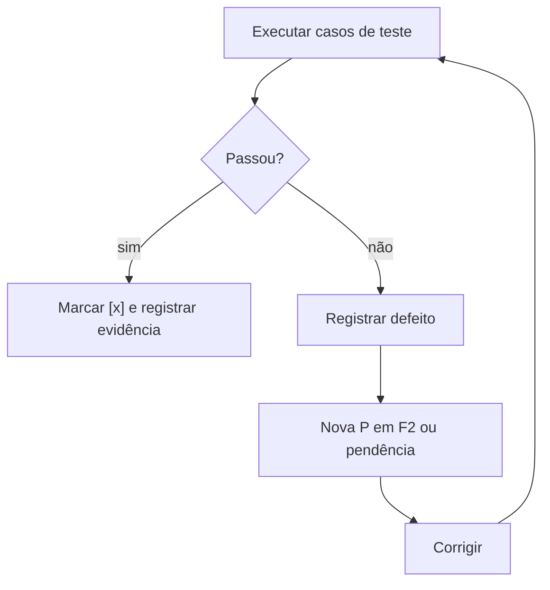

# G06 – Fase F3: Testes internos

**Objetivo:** provar que o sistema atende aos requisitos antes de chegar ao usuário.

F3 acontece **em paralelo** à implementação e também depois dela, de forma **recursiva**: cada defeito volta para a F2 e retorna ao teste.

## 1. Ciclo

## 2. Níveis de teste (ISO/IEC/IEEE 29119)

| Nível | Pergunta |
|---|---|
| Unitário | Cada função faz o que deve? |
| Integração | Os módulos conversam corretamente? |
| Sistema | O conjunto atende aos requisitos? |
| Regressão | O que já funcionava continua funcionando? |
| Segurança | Há falhas de acesso e vazamento? |
| Desempenho | Responde no tempo esperado? |

## 3. Plano de testes (`tst_`)

Seções mínimas: escopo, estratégia, ambiente, critérios de entrada e saída, casos (entrada, passos, resultado esperado), rastreio a REQ e RN, registro de defeitos.

## 4. Regras

- Todo caso de teste cita ao menos um REQ ou RN.
- Teste em execução usa o marcador `[t]`.
- Defeito corrigido exige reteste e, se o risco justificar, regressão.
- Evidências (logs, prints) não podem conter dado pessoal real.

## 5. Cobertura de rastreabilidade

$$
C_{rast} = \frac{R_{cob}}{R_{tot}} \times 100
$$

Onde:
- $$C_{rast}$$ (Cobertura de Rastreabilidade): percentual de requisitos com vínculo a pelo menos um teste e um commit.
- $$R_{cob}$$ (Requisitos cobertos): requisitos com teste e commit associados.
- $$R_{tot}$$ (Requisitos totais): requisitos aprovados do projeto.

Critério de saída proposto: $$C_{rast} = 100\%$$ para requisitos obrigatórios.

## 6. Checklist de saída (DoD da F3)

- [ ] Plano de testes executado
- [ ] Defeitos críticos e altos corrigidos
- [ ] Defeitos restantes registrados como pendência
- [ ] Matriz de rastreabilidade sem requisito obrigatório descoberto
- [ ] Relatório de testes (`rel_`) emitido
