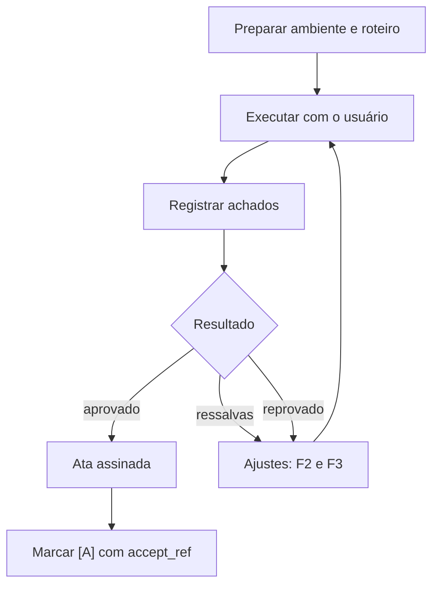

# G07 – Fase F4: Homologação

**Objetivo:** validar o sistema com o usuário final, em ambiente de homologação.

## 1. Preparação

| Item | Detalhe |
|---|---|
| Ambiente | Cópia fiel da produção, com dados fictícios ou anonimizados |
| Configuração GLPI | O kit traz `project.homolog.yaml.example` em `.glpi/` |
| Participantes | Usuários-chave, solicitante do chamado, equipe técnica |
| Roteiro | Cenários em linguagem do negócio, ligados aos REQ |

## 2. Fluxo

## 3. Ata de homologação (`hml_`)

Seções: participantes e data, escopo, cenários executados e resultado, achados (com gravidade), decisão (aprovado, aprovado com ressalvas, reprovado), prazos dos ajustes, assinaturas ou referência de aceite.

## 4. Regras

- Dado pessoal real não vai para homologação sem base legal e autorização (G12).
- Mudança pedida no teste é ajuste de escopo: nova P no plano e rastro no GLPI.
- O marcador `[A]` (closed) exige `accept_ref`, a referência do aceite (ata, e-mail ou parecer).
- Anexe evidências ao GLPI com a skill `glpi-document-attach`.

## 5. Checklist de saída (DoD da F4)

- [ ] Roteiro executado com o usuário
- [ ] Ata registrada e aceita
- [ ] Ajustes tratados ou formalizados como pendência
- [ ] Documentação de usuário e runbooks revisados com o que a homologação revelou
