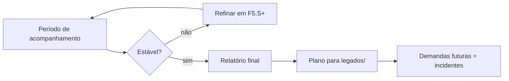

# G08 – Fase F5: Aprovação e acompanhamento em produção

**Objetivo:** acompanhar o uso real, refinar e encerrar o projeto com transição formal para a operação.

## 1. Atividades

| Atividade | Documento |
|---|---|
| Publicar em produção | Registro no plano e no GLPI |
| Acompanhar uso e métricas | `rel_` periódico |
| Corrigir e refinar | P em S da F5 (`F5.S1`, `F5.S2`…) |
| Consolidar operação | `ops_` (runbooks) |
| Registrar lições aprendidas | `rel_` final |
| Transferir para suporte | Ata de transição |

## 2. Runbook (`ops_`)

Seções mínimas: quando usar, pré-requisitos, passos numerados, verificação, reversão, contatos, última validação.

Runbooks típicos: implantação, backup e restauração, rotação de credenciais, tratamento de falha comum, monitoramento.

## 3. Encerramento

## 4. Regras

- Findo o acompanhamento, novas demandas entram como **incidentes** ITIL, não como novas P.
- Mudança grande vira novo chamado C e nova requisição R.
- Plano encerrado e anexos vão para `legados/` no mesmo ciclo.
- Itens aceitos recebem `[A]` com `accept_ref`.

## 5. Checklist de saída (DoD da F5)

- [ ] Runbooks validados
- [ ] Período de acompanhamento cumprido
- [ ] Relatório final com lições aprendidas
- [ ] Documentação revisada e `status` atualizado
- [ ] Planos em `legados/`
- [ ] Transição para incidentes comunicada
