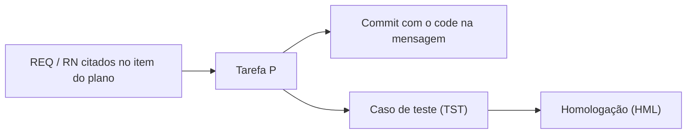

# G09 – Commits, PRs e rastreabilidade

Fonte canônica: skill `commit` (`.cursor/skills/commit/SKILL.md`) e o `AGENTS.md` do produto. Este guia resume e não substitui.

## 1. Formato da mensagem

```text
<gitmoji> <tipo>(<escopo>): <descricao-sem-acentos>_DD-MM-AA_hh-mm
```

Exemplos:

```text
✨ feat(web): shell operacional 4 paineis_05-10-26_13-58
📝 docs(docs): marca F2.S4.P5 em teste apos regressao_05-10-26_14-16
🐛 fix(backend): corrige upsert de cache_05-10-26_15-00
✅ test(backend): cobertura da fila offline F3.S1.P2_05-10-26_16-20
🚀 deploy(infra): homologacao F4.S1 em suporte-homolog_05-10-26_17-00
```

Onde:
- `gitmoji`: emoji que indica o tipo da mudança.
- `tipo`: `feat`, `docs`, `fix`, `refactor`, `test`, `deploy`.
- `escopo`: `backend`, `web`, `mobile`, `docs`, `infra`, `db` (o produto pode estender no `AGENTS.md`).
- `descricao-sem-acentos`: texto curto, **sem acentos**. Cite o code `F#.S#.P#` quando o commit mexe em um item do plano.
- `DD-MM-AA_hh-mm`: data e hora em formato brasileiro.

Não há rodapé `Refs:` nem `Req:`.

## 2. Gate de plano

```text
commit permitido  <=>  (delta_codigo vazio)  OU  (delta_plano nao vazio)
```

Onde:
- `delta_codigo`: arquivos de código do commit.
- `delta_plano`: arquivos de plano do commit.

Se a mensagem cita um code, o plano deve refletir o **mesmo status** no mesmo commit.

| Situação | Ação no plano |
|---|---|
| Implementou uma P | `[ ]` para `[~]`, `%`, `inicio_real` |
| Testou uma P internamente | `[~]` para `[t]`, `%` de 80 a 99 |
| Concluiu uma P | `[t]` para `[x]`, `%` igual a 100, `fim_real` |
| Concluiu todas as P de uma S | Fechar a S |
| Concluiu todas as S de uma F | Fechar a F e rodar `glpi-progress-rollup` |
| Aceite formal | `[x]` para `[A]` com `accept_ref` |
| Hotfix sem item no plano | Nota em "Concluído nesta sessão" ou abrir uma P |

Exceções: só formatação ou erro de digitação, arquivos gerados sem mudança funcional, e segredos (que **nunca** são commitados).

## 3. Checklist antes do commit

- [ ] Plano atualizado, ou exceção justificada
- [ ] Codes com fase (`F2.S4.P5`), nunca `S4` solto
- [ ] `real_*` coerentes com o marcador, nunca inventados
- [ ] Documentos de apoio afetados atualizados (dicionário, ADR, inventário LGPD)
- [ ] Build e testes da aplicação alterada
- [ ] Nada de segredo no stage
- [ ] Código e plano no mesmo `git add`

## 4. Depois do commit

1. Push **somente se o usuário pedir** (skill `exporte`).
2. Promoção entre ambientes (teste, homologa, `main`): o `FLUXO_COMMIT_CHECKLIST.md` cita o `FLUXO_BRANCHES_AMBIENTES.md`, mas esse arquivo **não existe** no kit. Até ele ser criado, siga a regra do produto no `AGENTS.md`.
3. Sugerir, sem executar sem pedido: `glpi-commit-harvest`, `glpi-tree-validate`, `glpi-progress-rollup`.


## 5. Rastreabilidade



- O item do plano ou do anexo cita os `REQ-nnn` e `RN-nnn` que atende.
- O commit cita o code `F#.S#.P#` na descrição.
- A matriz é **gerada** cruzando `git log` (codes), planos e anexos (REQ) e planos de teste.

| Requisito | Tarefa | Commits | Teste | Homologação |
|---|---|---|---|---|
| REQ-001 | F2.S1.P1 | `a1b2c3d` | TST-004 | HML-001 |

## 6. PR (proposta)

```markdown
## Rastreio
- Tarefa(s): F_.S_.P_
- Requisitos: REQ-___

## O que mudou
## Como testar
## Documentação
- [ ] Plano e anexo atualizados
- [ ] Dicionário e ER regenerados (se mexeu no esquema)
- [ ] ADR criado (se houve decisão)
- [ ] Inventário LGPD revisto (se mexeu em dado pessoal)
```
