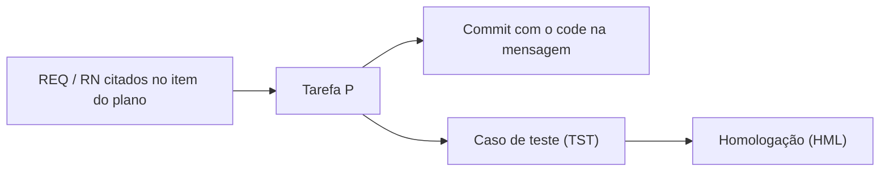

# G09 – Commits, PRs e rastreabilidade

Fonte canônica: skill `commit` (`.cursor/skills/commit/SKILL.md`) e o `AGENTS.md` do produto. Este guia resume e não substitui: em divergência, vale a skill.

Checklist operacional: `.cursor/skills/commit/FLUXO_COMMIT_CHECKLIST.md`.

## 1. Formato da mensagem

```text
<gitmoji> <tipo>(<escopo>): <descricao-sem-acentos>_DD-MM-AA_hh-mm
```

Exemplos:

```text
✨ feat(web): shell operacional 4 paineis_05-10-26_13-58
📝 docs(docs): marca F2.S4.P5 em teste apos regressao_05-10-26_14-16
🐛 fix(backend): corrige upsert de cache_05-10-26_15-00
✅ test(backend): cobertura da fila offline F3.S1.P2_05-10-26_16-20
🚀 deploy(infra): homologacao F4.S1 em suporte-homolog_05-10-26_17-00
📝 docs(docs): ajusta glossario, excecao gate: sem plano vigente_10-11-26_09-00
```

Onde:
- `gitmoji`: emoji que indica a natureza da mudança.
- `tipo`: `feat`, `fix`, `docs`, `refactor`, `test`, `deploy`.
- `escopo`: `backend`, `web`, `mobile`, `docs`, `infra`, `db` (o produto pode estender no `AGENTS.md`).
- `descricao-sem-acentos`: texto curto, **sem acentos**. Cite o code `F#.S#.P#` quando o commit mexe em um item do plano.
- `DD-MM-AA_hh-mm`: dia, mês, ano de dois dígitos, hora e minuto, no fuso `America/Sao_Paulo`.

Não há rodapé `Refs:` nem `Req:`. A rastreabilidade vem do code na descrição.

## 2. Gate de plano

```text
commit permitido  <=>  (delta_codigo vazio)  OU  (delta_plano nao vazio)  OU  (excecao documentada)
```

Onde:
- `delta_codigo`: arquivos de código no stage (`git diff --cached --name-only`).
- `delta_plano`: plano vigente e anexos incluídos no **mesmo** commit.
- `excecao documentada`: uma das exceções da seção 2.3, registrada na mensagem ou no status.
- `<=>`: "se e somente se".

Em palavras: quem muda código precisa mudar o plano no mesmo commit, salvo exceção registrada. Se a mensagem cita um code, o plano deve refletir o **mesmo status**.

### 2.1 Quando atualizar o plano

| Situação | Ação no plano |
|---|---|
| Implementou uma P | `[ ]` para `[~]`, `%`, `inicio_real` |
| Testou uma P internamente | `[~]` para `[t]`, `%` de 80 a 99 |
| Concluiu uma P | `[t]` para `[x]`, `%` igual a 100, `fim_real` |
| Concluiu todas as P de uma S | Fechar a S (`[x]`, `%`, `fim_real`) |
| Concluiu todas as S de uma F | Fechar a F e rodar `glpi-progress-rollup` |
| Aceite formal (F5) | `[x]` para `[A]` com `accept_ref` |
| Entrega só de documentação ou plano | Commit `docs`, sem mudar o status de código |
| Hotfix sem item no plano | Nota em "Concluído nesta sessão" ou abrir uma P. Não deixar órfão |

### 2.2 Marcadores, percentual e datas

| Marcador | Papel | `%` | `inicio_real` | `fim_real` |
|---|---|---|---|---|
| `[ ]` | todo (a fazer) | 0 | vazio | vazio |
| `[~]` | doing (em andamento) | maior que 0 e menor que 80 | obrigatório | vazio |
| `[t]` | testing (em teste) | 80 a 99 | obrigatório | vazio |
| `[x]` | done (concluído) | 100 | obrigatório | obrigatório |
| `[A]` | closed (aceite formal) | 100 | obrigatório | obrigatório, com `accept_ref` |

Onde:
- `%`: percentual de conclusão.
- `inicio_real` e `fim_real`: datas realizadas. **Nunca inventar.** Sem evidência, o campo fica vazio, e o planejado não é copiado para o real.
- `accept_ref`: referência do aceite (termo, ata ou parecer).

Os quatro campos visíveis são `inicio`, `fim`, `inicio_real` e `fim_real`. Se existirem, prevalecem sobre o comentário legado `<!-- glpi: ... -->`.

### 2.3 Exceções

Registrar na mensagem ou no status:

- Commit **só** de formatação ou erro de digitação, sem impacto de fase.
- Lockfile ou arquivo gerado, sem mudança funcional (o plano só entra se o P for de dependências ou infraestrutura).
- **Sem plano vigente** em `planos_ativos/` (template ou kit): não inventar plano; registrar na mensagem `excecao gate: sem plano vigente`.
- Segredos e `.env`: **nunca** commitar. Planos não contêm senha, token ou dado sensível.

## 3. Checklist antes do commit

- [ ] Code afetado com fase (`F2.S4.P5`), nunca `S4` solto, **ou** exceção documentada
- [ ] Plano e anexo atualizados, ou justificativa da exceção
- [ ] `inicio_real`, `fim_real` e `%` coerentes com o marcador, nunca inventados
- [ ] Documentos de apoio afetados atualizados (dicionário, ADR, inventário LGPD, runbook)
- [ ] Documentação no stage validada: `python3 scripts/docs/lint_docs.py` com 0 erros
- [ ] Build e testes da aplicação alterada
- [ ] Nada de segredo no stage
- [ ] Código e plano no mesmo `git add`

## 4. Depois do commit

1. Push **somente se o usuário pedir** (skill `exporte`). Nunca usar `--force` em `main` ou `master`.
2. Promoção entre ambientes (teste, homologação, `main`): seguir a regra do `AGENTS.md` do produto. O kit não tem arquivo próprio sobre isso.
3. Sugerir, sem executar sem pedido: `glpi-commit-harvest`, `glpi-tree-validate` e `glpi-progress-rollup`.
4. Follow-up no chamado, **opcional**: skill `acompanhar-chamado`.
5. Ajuste pontual de um nó no GLPI: skill `glpi-node-upsert`.

## 5. Rastreabilidade



- O item do plano ou do anexo cita os `REQ-nnn` e `RN-nnn` que atende.
- O commit cita o code `F#.S#.P#` na descrição.
- A matriz é **gerada** cruzando `git log` (codes), planos e anexos (REQ) e planos de teste.

| Requisito | Tarefa | Commits | Teste | Homologação |
|---|---|---|---|---|
| REQ-001 | F2.S1.P1 | `a1b2c3d` | TST-004 | HML-001 |

## 6. PR (proposta)

```markdown
## Rastreio
- Tarefa(s): F_.S_.P_
- Requisitos: REQ-___

## O que mudou
## Como testar
## Documentação
- [ ] Plano e anexo atualizados
- [ ] `lint_docs.py` sem erros
- [ ] Dicionário e ER regenerados (se mexeu no esquema)
- [ ] ADR criado (se houve decisão)
- [ ] Inventário LGPD revisto (se mexeu em dado pessoal)
```

## 7. Guias relacionados

| Guia | Assunto |
|---|---|
| G03 | Nomenclatura e front matter |
| G05 | Fase F2 – implementação |
| G10 | Sincronização com o GLPI |
| G14 | Cursor, extensões, agentes e skills |
