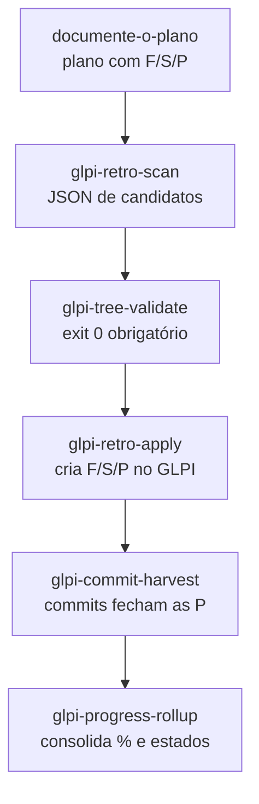

# G10 – Sincronização com o GLPI

Detalhes técnicos: `docs/06_glpi/` (manuais e `GUIA_USO_INTEGRACAO_VSCODE_GLPI.md`). Este guia mostra **quando** usar cada etapa.

## 1. Pipeline

Observação: a skill `glpi-node-upsert` substituiu a antiga `glpi-task-upsert`. Use sempre a nova.

As skills sugeridas (scan, validate) **não são executadas sem pedido** do usuário.

## 2. Estados

| Marcador | Papel no plano | Observação |
|---|---|---|
| `[ ]` | todo | Sem datas reais |
| `[~]` | doing | Só `inicio_real` |
| `[t]` | testing | Estado "Testando" da instância |
| `[x]` | done | `inicio_real` e `fim_real` |
| `[A]` | closed | Exige `accept_ref` |

## 3. Datas e durações

- Obrigatórias em F, S e P: `plan_start_date`, `plan_end_date`, `planned_duration`, `effective_duration`.
- `real_*` só com evidência (plano, comentário `glpi:` ou commit).
- Item planejado sem evidência: bloco estipulado de 2 h e `effective_duration = 0`.
- Sessão e fase usam a janela que cobre os filhos.
- Duração efetiva é o intervalo entre as datas reais, em segundos. Commit instantâneo dá 0.

## 4. Conteúdo do item

O `content` da ProjectTask diz a **natureza e a finalidade**, não repete o título. O rascunho sai de `draft_purpose`, e o escriba o reescreve com plano, commit, sessão e documentos de `docs/`.

## 5. Segurança

- Credenciais ficam em `.glpi/glpi.env`, criado a partir de `glpi.env.example`. **Nunca versionar.**
- `lint_template.py` bloqueia padrões que parecem token ou chave de produção. Exemplos em `docs/06_glpi/` e arquivos `.example` são tolerados.
- Nos documentos, use placeholders (`<TOKEN>`).

## 6. Anexar documentos

Use a skill `glpi-document-attach` para anexar atas, relatórios e evidências ao item correspondente.

## 7. Boas práticas

1. Sincronize ao fim de cada sessão.
2. Rode a validação antes de aplicar.
3. Não edite F/S/P direto no GLPI. Edite o plano e reaplique.
4. Se o GLPI e o plano divergirem, o plano vence para o que vai acontecer e o commit vence para o que aconteceu.
