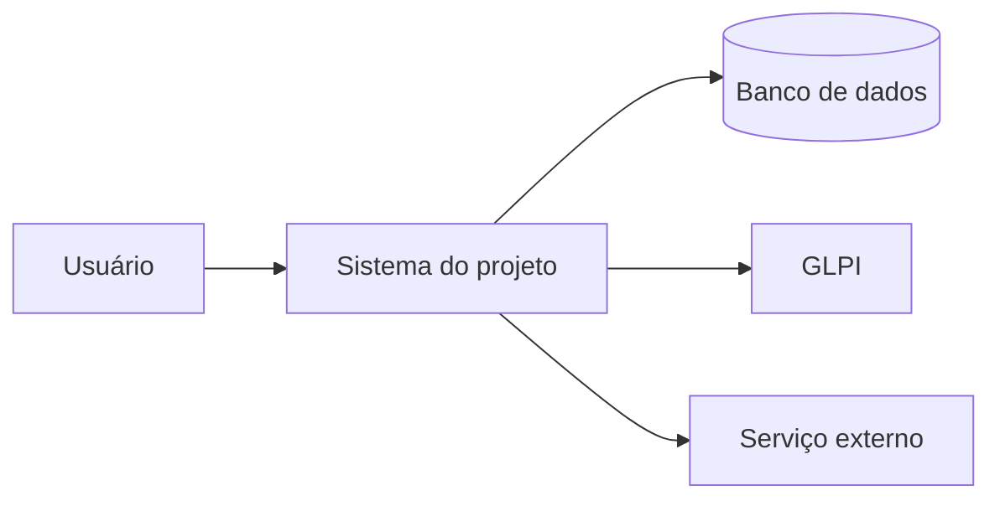
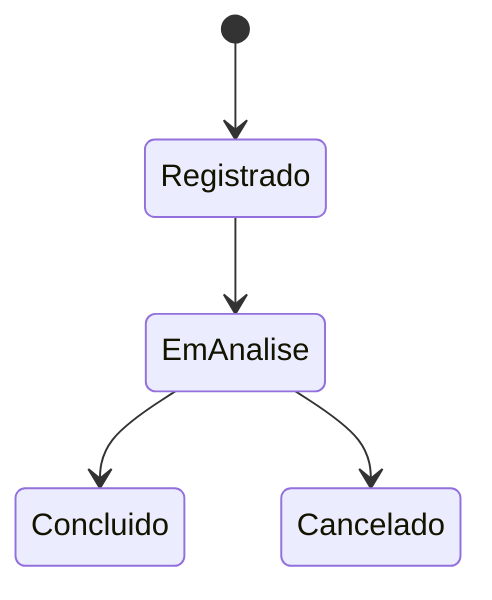

# G13 – Diagramas como código

## 1. Regra geral

Todo diagrama é **texto versionado** (Mermaid, preferencialmente). Imagens exportadas servem só como cópia de apresentação.

## 2. Qual diagrama usar

| Necessidade | Tipo Mermaid | Guia ou fase |
|---|---|---|
| Contexto do sistema | `flowchart` (estilo C4 nível 1) | F1 |
| Componentes e implantação | `flowchart` com subgrafos | F1, F2 |
| Fluxo de processo | `flowchart` | Todas |
| Estados | `stateDiagram-v2` | F1, F2 |
| Sequência de integração | `sequenceDiagram` | F2 |
| Modelo de dados | `erDiagram` | G11 |
| Cronograma | `gantt` | F1 |

## 3. Onde guardar

| Situação | Local |
|---|---|
| Diagrama dentro de um documento | Bloco ```mermaid no próprio `.md` |
| Diagrama reutilizado | `docs/08_imagens/diagramas/<nome>.mmd` |
| Exportação | `docs/08_imagens/exportados/<nome>.svg` |
| ER de dados | `docs/09_dados_e_tabelas/er/` |

## 4. Boas práticas

1. Um diagrama, uma ideia. Se passar de cerca de 25 nós, divida por módulo.
2. Nomes dos nós em português, curtos, sem abreviação obscura.
3. Evite acentos e parênteses dentro de identificadores de nó; use rótulos entre aspas.
4. Sempre inclua legenda com `Onde:` quando houver notação especial.
5. Mostre no ER só chaves e campos relevantes; o detalhe fica no dicionário.

## 5. Exemplos

Contexto (C4 nível 1):



Estados:



## 6. Renderização

- No Cursor: extensão de pré-visualização Mermaid (G14).
- No portal: MkDocs Material com `pymdownx.superfences` configurado para Mermaid.
- PlantUML é opcional (exige Java e Graphviz).
