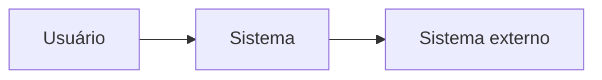

# {{titulo}}

## Objetivo
<Problema que o projeto resolve, em poucas frases. Cite o chamado no cabeçalho do plano, não aqui.>

## Escopo
**Dentro do escopo:** <lista>

**Fora do escopo:** <lista>

## Partes interessadas
| Papel | Nome ou área | Interesse |
|---|---|---|

## Contexto (C4 nível 1)

